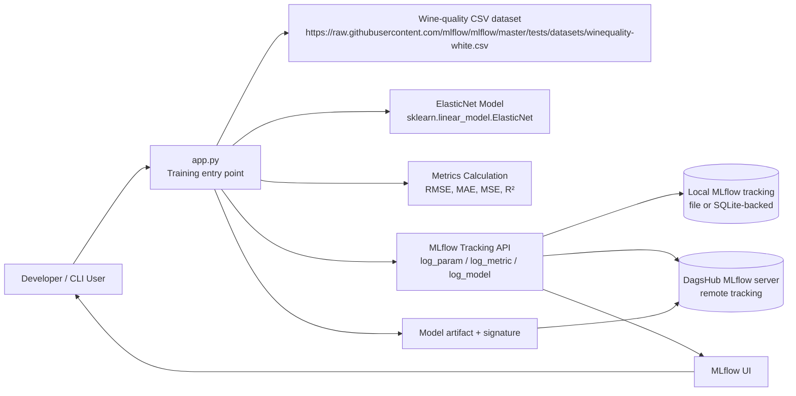
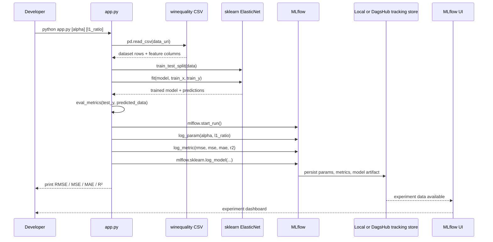

# MLflow Repository Architecture Report

## Repository overview
This repository is a compact Python experiment-tracking exercise. It trains an `ElasticNet` regressor from scikit-learn against the wine-quality dataset, logs metrics and parameters with MLflow, and can send those logs to a DagsHub-hosted MLflow remote or keep them in a local MLflow tracking store.

The repository is intentionally minimal: a single Python script (`app.py`) and a dependency file (`requirements.txt`). There is no web application, no REST API, and no database layer beyond the MLflow tracking backend selected at runtime.

## Evidence reviewed
- `README.md` describes both local and DagsHub workflows: https://github.com/Rajkumar-Ai-Engineer/MLFLOW/blob/main/README.md#L9-L118
- `app.py` is the actual execution path and MLflow integration point: https://github.com/Rajkumar-Ai-Engineer/MLFLOW/blob/main/app.py#L40-L89
- `requirements.txt` confirms the runtime dependencies: https://github.com/Rajkumar-Ai-Engineer/MLFLOW/blob/main/requirements.txt#L1-L2

## Architecture diagrams

### 1) High-level system architecture


### 2) Detailed component architecture
```mermaid
flowchart TB
    User[Developer] --> CLI[python app.py\nCLI entry point]

    subgraph App[Application layer]
        Loader[Dataset Loader\npd.read_csv]
        Splitter[Train/Test Split\ntrain_test_split]
        Trainer[ElasticNet Trainer\nElasticNet(alpha, l1_ratio)]
        Metrics[Metrics Evaluator\neval_metrics]
        Logger[MLflow Logger\nstart_run + log_*]
    end

    subgraph External[External systems]
        Source[Wine-quality dataset\nremote CSV]
        Remote[(DagsHub MLflow backend)]
        UI[MLflow UI]
    end

    subgraph Store[Persistence]
        Local[(Local MLflow tracking store)]
    end

    CLI --> Loader
    Loader --> Source
    Loader --> Splitter
    Splitter --> Trainer
    Trainer --> Metrics
    Metrics --> Logger

    Logger --> Local
    Logger --> Remote
    Remote --> UI
    UI --> User
```

### 3) End-to-end data flow


## Component documentation

### `app.py`
Role: single entry point and training workflow orchestrator.
Responsible for:
- downloading the dataset,
- splitting it into train/test sets,
- training an `ElasticNet` model,
- evaluating model performance,
- logging parameters, metrics, and model artifact to MLflow,
- optionally initializing DagsHub remote tracking.

Evidence: https://github.com/Rajkumar-Ai-Engineer/MLFLOW/blob/main/app.py#L40-L89

### `requirements.txt`
Role: declares runtime dependencies.
Installed items: `mlflow` and `dagshub`.

Evidence: https://github.com/Rajkumar-Ai-Engineer/MLFLOW/blob/main/requirements.txt#L1-L2

### `README.md`
Role: user-facing guide documenting local tracking and remote DagsHub tracking.
It explains default run commands and environment variables.

Evidence: https://github.com/Rajkumar-Ai-Engineer/MLFLOW/blob/main/README.md#L30-L118

## Dependency and integration map
- Data source: remote CSV file from the official MLflow test datasets (`https://raw.githubusercontent.com/mlflow/mlflow/master/tests/datasets/winequality-white.csv`)
- ML library: scikit-learn (`ElasticNet`, `train_test_split`, metric functions)
- Tracking layer: MLflow (`mlflow.start_run`, `mlflow.log_param`, `mlflow.log_metric`, `mlflow.sklearn.log_model`)
- Remote backend: DagsHub via `dagshub.init(repo_owner='Rajkumar-Ai-Engineer', repo_name='MLFLOW', mlflow=True)`
- UI: `mlflow ui` for local dashboard access

## Architecture findings
- This is a thin ML experimentation script, not a multi-service application.
- The main dependency and integration boundary is MLflow: it acts as both the experiment log and the model artifact store.
- The code is strongly coupled to the default workflow in a single file; there are no separate modules for data loading, training, tracking, or model evaluation.
- Remote tracking is configured directly in code and not abstracted behind environment-driven config; this creates a hard dependency on the DagsHub repo and credentials.
- There are no tests, no CI workflow, and no meaningful deployment configuration in the repository as inspected.

## Uncertainties and limitations
- The repository is intentionally small and does not implement a user-facing app, service layer, database schema, or API.
- The presence of a tracked `.env` file in the repo tree was observed, but its contents were not inspected in order to avoid exposing credentials or secrets.
- The exact local MLflow backend implementation (file store vs SQLite) is not encoded in this repository; MLflow chooses it based on configuration and defaults.
- No Docker, Kubernetes, IaC, or cloud deployment files were present in the inspected repository tree.

## Saved diagram files
- `architecture-overview.mmd`
- `component-architecture.mmd`
- `data-flow.mmd`
